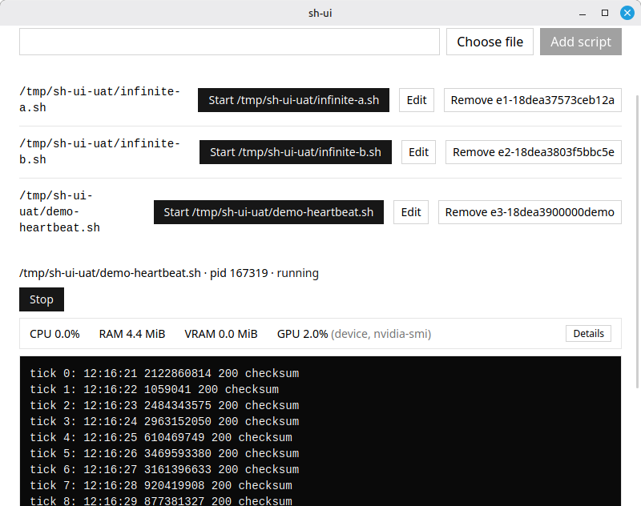

# sh-ui

**Десктопное приложение для Linux, которое ведёт реестр ваших shell-скриптов** — запускает
их с вашими аргументами, окружением и рабочей директорией; показывает вывод в реальном
времени; показывает, сколько скрипт стоит; останавливает его одним нажатием; и никогда не
оставляет «висящих» процессов.

[English version](README.md)



## Что умеет

- **Реестр скриптов.** Регистрируется любой исполняемый файл. Для каждого скрипта можно
  сохранить аргументы (argv), пары окружения `KEY=VALUE` и рабочую директорию. Реестр
  переживает перезапуск приложения.
- **Живой вывод.** stdout и stderr поступают в интерфейс по мере работы скрипта;
  потерянные строки считаются и видны на экране, а окно приложения не разрастается
  бесконечно.
- **Живая стоимость.** Загрузка CPU (в процентах от одного ядра, как в top) и резидентная
  память скрипта и всего его дерева процессов — обновление раз в секунду.
- **GPU и VRAM — честно.** Если машина может измерять (nvidia-smi, amd-smi, rocm-smi,
  intel_gpu_top), показываются VRAM по процессам запуска и загрузка устройства. Если
  измерить нельзя — приложение прямо говорит почему, вместо догадок.
- **Остановка одним нажатием.** Каждый запуск стартует как отдельная группа процессов.
  Stop посылает SIGTERM всей группе, затем SIGKILL через две секунды. Ответвившиеся
  дочерние процессы умирают вместе с родителем.
- **Честный статус завершения.** Каждый завершённый запуск получает `exited`, `failed`
  или `stopped` — по реальному коду выхода и сигналу, без догадок.
- **Ничего не остаётся запущенным.** Закрытие приложения останавливает все живые запуски.
  Если приложение упало, следующий запуск «вырежет» оставленные группы сирот — по
  совпадению времени старта процесса, поэтому переиспользованный pid не будет убит.

## Как устроено

Хост на Rust (Tauri) владеет процессами: запускает каждый скрипт напрямую как лидера
группы процессов (`setsid`), следит за ним, ограничивает вывод 8 КиБ на событие и читает
`/proc` через крейт `procfs`. React-интерфейс общается с хостом только через Tauri IPC —
никаких сетевых портов и вторых демонов. Реестр и файл восстановления живых запусков —
обычные JSON-файлы в каталоге данных приложения.

```
src-tauri/   Хост на Rust: супервизор, метрики, GPU-пробы, реестр, восстановление
src/         React-интерфейс: features/registry, features/runs, общие компоненты
```

## Установка

Только Linux (хост читает `/proc`).

Из готового бандла:

```sh
sudo dpkg -i sh-ui_0.1.0_amd64.deb    # deb
sudo rpm -i sh-ui-0.1.0-1.x86_64.rpm  # rpm
./sh-ui_0.1.0_amd64.AppImage          # AppImage
```

## Сборка из исходников

Требуется: Node 22, Rust, Linux-тулчейн для десктопа (см.
[Tauri prerequisites](https://tauri.app/start/prerequisites/)).

```sh
npm install
npm run tauri dev      # разработка
npm run tauri build    # релизные бандлы -> src-tauri/target/release/bundle/
```

## Тесты и линт

```sh
npm run lint           # ESLint + tsc --noEmit + clippy -D warnings
npm run test           # Vitest (UI) + cargo test (хост)
npm run preflight      # полный гейт: lint && test && cargo test && build
```

## Источники GPU-измерений

| Источник | Условие |
|---|---|
| `nvidia-smi` | VRAM по процессам через `--query-compute-apps` |
| `amd-smi` / `rocm-smi` | запросы процессов и устройства, где доступны |
| `intel_gpu_top` | только загрузка устройства и только без root |
| ничего из списка | приложение сообщает явное состояние «недоступно» с причиной |

## Версия

0.1.0 — содержимое релиза в `specs/release-plan.yaml`, полные спецификации, решения по
архитектуре и доказательства проверки в `specs/`.
